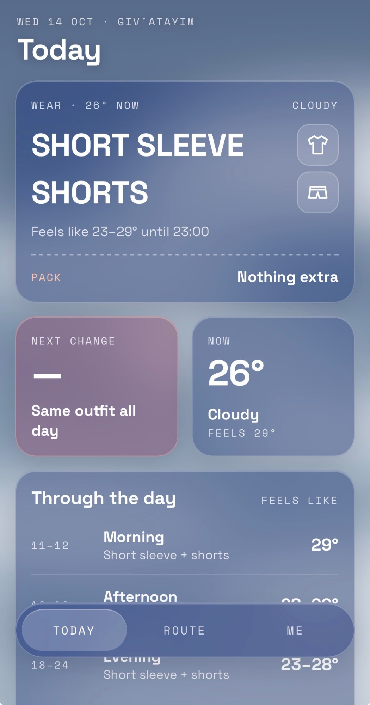
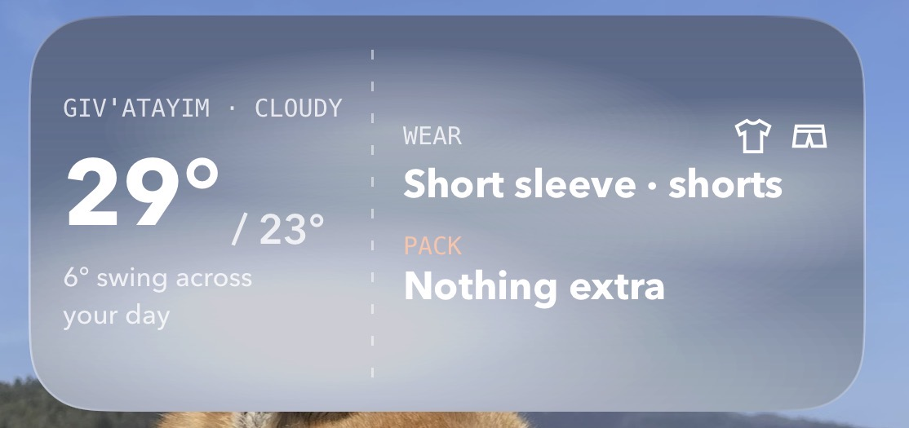

<h1 align="center">What2Wear</h1>

  <b>Short sleeve or long? Shorts or pants? Sweater, coat, umbrella?</b> 
  An iPhone home screen widget and pocket app that reads the weather where you are 
  and tells you, in plain words, what to wear and what to take with you.

<code>Version 1.01</code> · October 2026 · iPhone · Celsius

  
  &nbsp;&nbsp;&nbsp;
  

---

## Contents

- [The idea](#the-idea)
- [What you see](#what-you-see)
  - [The home screen widget](#the-home-screen-widget)
  - [The app: Today](#the-app-today)
  - [The app: Route](#the-app-route)
  - [The app: Me](#the-app-me)
- [How it decides what you wear](#how-it-decides-what-you-wear)
- [Planning a trip](#planning-a-trip)
- [The look](#the-look)
- [How it's built](#how-its-built)
- [Privacy](#privacy)
- [Version history](#version-history)
- [Known limitations](#known-limitations)
- [Ideas for later](#ideas-for-later)
- [Credits](#credits)

---

## The idea

Weather apps answer "what is the weather?". What you actually want to know on the way out the door is **"what do I put on, and do I need to take anything?"**

What2Wear answers that question directly. It looks at how warm it will *feel* where you are for the rest of the day, not just right now, and turns it into a short outfit:

> **Short sleeve · shorts**
> **Pack:** sweater (from 19:00) · umbrella (70% rain around 20:00)

It sits on the home screen as a widget, so the answer is there every time you unlock your phone, and it opens into a small app for the rest of the day, for trips, and for tuning it to how warm or cold you usually feel.

---

## What you see

### The home screen widget

The widget comes in three sizes. Each one shows today's outfit on a sky that matches the current weather, and tapping it opens the app.

| Size | What's on it |
| --- | --- |
| **Small** | The temperature now, the outfit in large letters (for example **SHORT SLEEVE / SHORTS**) with a clothing icon beside each item, a dashed ticket line, and what to **pack**. |
| **Medium** | Left: your town, the conditions, the warmest and coldest the day will feel (for example **29° / 23°**) and how much it swings. Right: **Wear** and **Pack**, each with its clothing icons, plus *when*: "from 19:00", "70% rain 20:00". |
| **Large** | Everything in the medium widget, plus the day split into **morning, afternoon and evening** (what each part adds, and how warm it feels), and the **next change** to your outfit, for example "19:00 · Sweater on". |

From 21:00 the widget switches to **tomorrow**, so the last thing you see at night is what to lay out for the morning.

### The app: Today

Open the widget, or run the app, and you land on **Today**:

- **Wear**: the outfit in large letters, one item per line, each with its icon in a small glass tile. Below it: what the day will feel like from now until 23:00.
- **Pack**: what goes in your bag, with icons, and a sentence saying exactly when you'll need it ("Sweater from 19:00. 70% rain around 20:00.").
- **Next change**: the next moment your outfit changes, for example **19:00 · Sweater on, 13° by 19:00**, or "Same outfit all day".
- **Now**: the current temperature, the conditions and what it feels like.
- **Through the day**: morning, afternoon and evening, each with its feels-like range and what that part of the day adds, such as "+ sweater, umbrella".
- **Tuned for**: which hot/cold setting the advice uses (see [Me](#the-app-me)).

### The app: Route

**Route** plans what to wear when you won't be at home: a day out in another city, or a whole journey with several stops.

- **Add a place** by typing a city or town. English and Hebrew both work, and so does "City, Country". If the phone's keyboard won't open in the text field, a link opens Scriptable's own pop-up text box instead.
- Pick the right match ("Paris, France", not "Paris, Texas"), then the day you **arrive** and the day you **leave**.
- Each stop gets a boarding-pass style card: a three-letter code (**PAR**, **ROM**), the dates, how warm it will feel there, what to **wear** and what to **pack**. If a stop needs something the previous one didn't, the card turns rose-coloured and shows a **layer change**, for example "Layer change · −10°: + Coat · + Umbrella".
- **Day by day** lists every date of the trip, where you'll be and what to wear.
- **Bag check** is a packing list for the whole trip, counted in days ("Long-sleeve tops: 6 days", "Compact umbrella: 2 days"), with boxes to tick off as you pack.

The route is saved on the phone, so you can come back to it. Stops that are over drop off by themselves.

### The app: Me

**Me** is where you tell it how you feel the weather compared with most people:

| Setting | Effect |
| --- | --- |
| I'm always cold | treats every day as 4° colder |
| I run a bit cold | 2° colder |
| Average | as forecast |
| I run a bit hot | 2° warmer |
| I'm always hot | 4° warmer |

Below that, **Your rules** shows every threshold already adjusted for your setting, so you can see exactly when it will tell you to wear shorts or bring a coat. The home screen widget follows the same setting.

---

## How it decides what you wear

Everything is based on the **"feels like"** temperature (which takes wind and humidity into account) and the **chance of rain**, hour by hour, for the hours you're likely to be out: **07:00 to 23:00**, or from now until 23:00 for the rest of today.

The thinking: **you dress for the warmest part of the day, and carry a layer for the coldest.**

| You get | When |
| --- | --- |
| **Short sleeve** | the warmest part of the day feels **22° or more** (otherwise **long sleeve**) |
| **Shorts** | the warmest part feels **25° or more** *and* it never drops below **16°** (otherwise **pants**) |
| **Sweater** | the coldest part feels **below 18°** |
| **Coat** | the coldest part feels **below 11°** |
| **Warm coat** (+ scarf) | the coldest part feels **below 4°** |
| **Umbrella** | the chance of rain reaches **40%** at any point (or, where no chance is given, at least 1 mm of rain is expected) |

All the temperature thresholds shift with your [hot/cold setting](#the-app-me).

A few details that make the advice feel right:

- **Worn or packed?** If even the warmest part of the day is too cold for short layers, the sweater or coat goes under **Wear**. If it's only needed for part of the day, it goes under **Pack** with the time: "from 19:00", "until 10:00", or "morning & evening".
- **Shirt and pants are separate decisions.** Shorts need warmer weather than short sleeves, so you get the realistic combinations: short sleeve + shorts, short sleeve + pants, long sleeve + pants.
- **The whole day counts, not just now.** A warm afternoon that turns cold at night gives you short sleeves *and* a sweater in the bag.
- **Rain comes with a time.** It tells you roughly when the rain is most likely, not just that it might rain.

---

## Planning a trip

- **Up to about two weeks ahead** it uses the real hourly forecast.
- **Further ahead** (trips planned weeks or months in advance) a forecast doesn't exist yet, so it looks up the **same dates over the last five years** and uses what's typical: the average warmest and coldest feel, and how often it rained. Those days are clearly marked **Typical**, with a reminder to check again closer to the trip.
- **Travel days count twice.** On the day you leave one stop for the next, it dresses you for both places. On the first and last day of a trip it also includes where you are now, since that's where you set off from and come back to.
- Each stop can be up to 30 days long, and stops can be planned up to about ten months ahead.

---

## The look

What2Wear is designed to feel like the iPhone's own Weather app, crossed with a boarding pass.

- **Skies that follow the weather.** The background changes with the conditions where you are: a bright blue sky with a sun glow and drifting clouds on clear days, grey layers when it's overcast, haze in fog, falling rain, rain with lightning flashes in a storm, falling snow, a starry night with a moon, and a navy-to-orange sky around sunrise and sunset. In the app these are animated.
- **Frosted glass.** The cards in the app are translucent glass that blurs the sky behind them. On the home screen, where widgets can't blur, the sky is painted into the widget with a glass tint and a soft sheen along the top.
- **Ticket typography.** Small spaced-out monospace labels (WEAR, PACK, NEXT CHANGE), big bold outfit words, dashed perforation lines, three-letter place codes, and a warm peach accent for anything you need to pack.
- **Clothing icons.** Simple line icons for short sleeve, long sleeve, shorts, pants, sweater, coat and umbrella, drawn the same way in the app and in the widget.

---

## How it's built

What2Wear runs inside **[Scriptable](https://scriptable.app)**, a free iPhone app that runs JavaScript and can put the result on the home screen as a widget. That choice means no Mac, no App Store developer account and no cost: the whole project is a single script on the phone.

| Part | How |
| --- | --- |
| **Language** | JavaScript, about 1,400 lines in one file |
| **Widget** | Drawn natively with Scriptable's widget tools. The sky and the clothing icons are painted as images. |
| **App** | A single web page shown inside Scriptable, with three tabs. The same outfit logic runs in both the widget and the app, so they always agree. |
| **Weather** | [Open-Meteo](https://open-meteo.com): the hourly forecast (feels-like temperature, chance and amount of rain, sunrise and sunset, 16 days ahead), its place search, and its historical archive for "typical" weather. Free, with no account or API key. |
| **Location** | The phone's location, to about 1 km, with the last known place remembered for when the widget can't get a fresh fix. |
| **Storage** | A small settings file on the phone: your hot/cold setting, your route and your bag check ticks. |
| **Fonts** | Space Grotesk and Space Mono in the app; Avenir Next and Menlo, built into iOS, in the widget. |

The widget asks iOS to refresh it about every 30 minutes.

---

## Privacy

- **No account, no server, no tracking.** Nothing is sent anywhere except the weather requests.
- **Your location is rounded to about 1 km** before it's used to ask for the weather, so your exact position never leaves the phone.
- Place names you search for go to Open-Meteo's place search.
- Your settings and route are stored only on your phone.

---

## Version history

### 1.01: October 2026 (current)

The first published version.

- Home screen widget in small, medium and large.
- App with **Today**, **Route** and **Me** tabs.
- Outfit advice: short or long sleeve, shorts or pants, sweater, coat or warm coat, umbrella, with the time each is needed.
- Hot/cold personal tuning.
- Multi-stop trip planning with travel days, typical weather for far-off dates, and a bag check.
- Glass design with weather-reactive skies, ticket-style typography and clothing icons.
- Place search in English and Hebrew, and forgiving of "City Country" input.
- Pop-up text entry for when the in-app keyboard won't open.

---

## Known limitations

- **iOS decides when widgets refresh.** The widget asks for about every 30 minutes, but iOS may update it less often. After an update to the script, the widget can take a while to change, and removing and re-adding it forces a refresh.
- **Stops are planned by day, not by hour.** You can't yet say "office at 10:00, dinner in another city at 19:00".
- **"Typical" is an average, not a forecast.** For dates more than about two weeks away the advice is only as good as past years.
- **Needs an internet connection** to fetch the weather. The app's fonts also load from the internet the first time.
- **English interface**, Celsius only.
- **Tested on one iPhone so far.** Screen sizes other than the tested one may show small layout differences.

---

## Ideas for later

These ideas came out of the design work and aren't built yet:

- **Plan my day by the hour:** home at 08:30, office at 10:00, dinner in another city at 19:00, with one outfit that works for all of it.
- **Add stops from the calendar** instead of typing them.
- **A closet:** tell it what you actually own, so it suggests *your* clothes.
- **A "next change" widget:** a small widget that only shows the next moment to add or remove a layer.
- **Lock screen widget.**

---

## Credits

- Weather data by **[Open-Meteo.com](https://open-meteo.com)**, licensed under [CC BY 4.0](https://creativecommons.org/licenses/by/4.0/).
- Runs on **[Scriptable](https://scriptable.app)** by Simon B. Støvring.
- Fonts: **Space Grotesk** by Florian Karsten and **Space Mono** by Colophon Foundry, both under the SIL Open Font License, via Google Fonts.

The source code for What2Wear is kept private.

